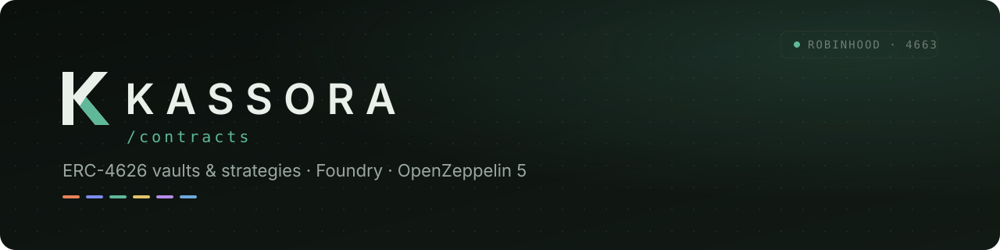
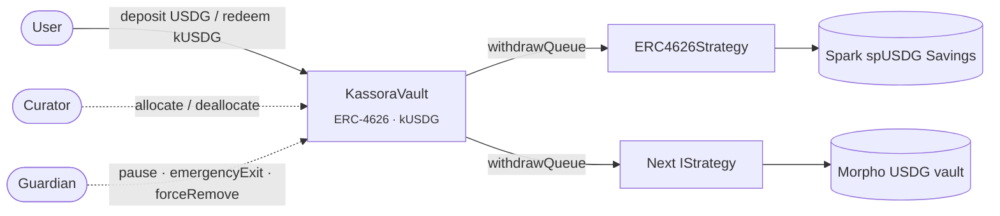
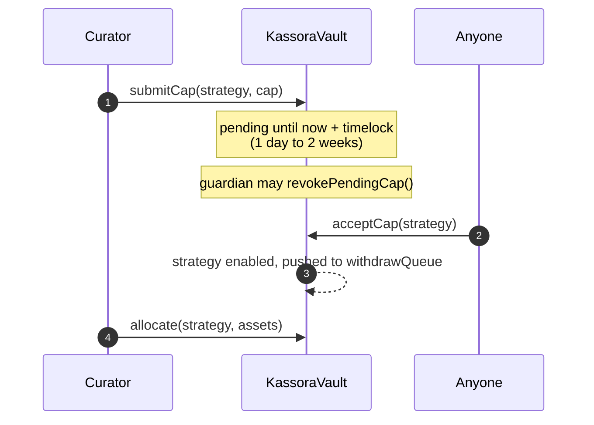

<div align="center">



<h3>ERC-4626 vaults and pluggable yield strategies for Robinhood Chain</h3>

<p>
  
  
  
  
  
  <a href="./LICENSE"></a>
</p>

<p>
  <a href="#-overview">Overview</a> ·
  <a href="#-architecture">Architecture</a> ·
  <a href="#-guardrails">Guardrails</a> ·
  <a href="#-roles--permissions">Roles</a> ·
  <a href="#-quickstart">Quickstart</a> ·
  <a href="#-deploy">Deploy</a> ·
  <a href="./SECURITY.md">Security</a>
</p>

</div>

> [!WARNING]
> These contracts are **unaudited** and **not deployed**. Do not use them with funds you cannot afford to lose. See [SECURITY.md](./SECURITY.md).

## ✨ Overview

Kassora is a transparent, on-chain vault for **USDG** on [Robinhood Chain](https://docs.robinhood.com/chain/) (chain ID `4663`, Arbitrum Orbit L2, gas in ETH).

Users deposit USDG and receive **kUSDG**, a standard ERC-4626 share. A curator routes the deposits into **capped strategies**, such as Spark spUSDG Savings or a Morpho USDG vault. Every risk-increasing change waits behind an on-chain **timelock**, so depositors can see it coming and leave first.

| Contract | What it does |
| --- | --- |
| [`KassoraVault`](src/KassoraVault.sol) | ERC-4626 vault over one asset. Holds idle funds, routes the rest to capped strategies, charges a capped performance fee. |
| [`IStrategy`](src/interfaces/IStrategy.sol) | Seven-function adapter interface. Add a new yield source without touching the vault. |
| [`ERC4626Strategy`](src/strategies/ERC4626Strategy.sol) | Adapter into any existing ERC-4626 vault. No owner, no admin keys. |

## 🏗 Architecture



**Share price.** `totalAssets()` is idle USDG plus each strategy's `totalAssets()`. kUSDG has **12 decimals**: USDG's 6 plus a virtual-share offset of 6.

**Withdrawals.** Idle funds go first. Then the vault pulls from strategies in `withdrawQueue` order. A strategy whose `withdraw` reverts is skipped, so one broken integration cannot block exits.

<details>
<summary><b>How a new strategy goes live</b></summary>



</details>

## 🛡 Guardrails

| | Guardrail | How it works |
| --- | --- | --- |
| 🧮 | **Inflation attack** | OpenZeppelin virtual shares with `decimalsOffset = 6`. A first-depositor donation attack costs more than it steals. |
| 🪣 | **Deposit cap** | `depositCap` limits total assets. `maxDeposit` shrinks as the vault fills. |
| 📏 | **Per-strategy cap** | `allocate` reverts above a strategy's cap. |
| ⏳ | **Timelock** | New strategy, higher cap, higher fee and shorter timelock all wait `timelock` (1 day to 2 weeks). Lowering risk is immediate. |
| ⏸ | **Pause** | The guardian pauses deposits and allocations. **Withdrawals are never paused.** |
| 💸 | **Fee ceiling** | `MAX_FEE = 30%` of profit, enforced in the contract. |
| 🚑 | **Broken strategy** | `emergencyExit` pulls everything out. `forceRemoveStrategy` drops a strategy whose views revert, without calling it, and pauses deposits. |
| 🔑 | **Two-step ownership** | `Ownable2Step`. The owner should be a multisig. |

> [!NOTE]
> **Fees have no high-water mark.** The fee is charged on any rise in `totalAssets` since the last accrual. After a loss, the recovery is charged too. This is the same model as Morpho MetaMorpho V1.

## 🔐 Roles & permissions

| Action | Owner | Curator | Guardian | Anyone | Timelocked |
| --- | :-: | :-: | :-: | :-: | :-: |
| Set curator / guardian / fee recipient | ✅ | | | | |
| Raise fee (max 30%) | ✅ | | | | ⏳ |
| Lower fee | ✅ | | | | |
| Shorten timelock | ✅ | | | | ⏳ |
| Lengthen timelock | ✅ | | | | |
| Add strategy / raise cap | ✅ | ✅ | | | ⏳ |
| Lower cap, set deposit cap, reorder queue | ✅ | ✅ | | | |
| Allocate / deallocate | ✅ | ✅ | | | |
| Remove an emptied strategy | ✅ | ✅ | | | |
| Pause deposits | ✅ | | ✅ | | |
| Unpause | ✅ | | | | |
| Revoke a pending change | ✅ | ✅ ¹ | ✅ | | |
| Emergency exit / force-remove a strategy | ✅ | | ✅ | | |
| Accept a pending change after the timelock | | | | ✅ | |
| Deposit, withdraw, accrue fee | | | | ✅ | |

<sub>¹ The curator can revoke pending caps only.</sub>

## 🚀 Quickstart

```bash
git clone --recurse-submodules https://github.com/kassoradev/kassora-contracts
cd kassora-contracts
forge build
forge test
```

| Suite | Path | Covers |
| --- | --- | --- |
| Unit + fuzz | [`test/KassoraVault.t.sol`](test/KassoraVault.t.sol) | Deposits, caps, timelocks, roles, fees, pause, emergency paths, inflation attack |
| Invariant | [`test/invariant/`](test/invariant) | `totalAssets` accounting, share supply, solvency |
| Fork | [`test/fork/RobinhoodFork.t.sol`](test/fork/RobinhoodFork.t.sol) | A live ERC-4626 USDG vault on chain 4663 (skipped without env) |

```bash
# fork test against a live ERC-4626 USDG vault on Robinhood Chain
ROBINHOOD_RPC_URL=https://rpc.mainnet.chain.robinhood.com \
FORK_TARGET_VAULT=0x... \
forge test --match-path "test/fork/*" -vvv
```

## 📦 Deploy

```bash
cp .env.example .env && source .env

# testnet: a mintable tUSDG and a plain ERC-4626 target to point the strategy at
forge script script/DeployMockUSDG.s.sol --rpc-url robinhood_testnet --account deployer --broadcast

# vault (+ strategy if TARGET_VAULT is set); writes deployments/<chainId>.json
forge script script/Deploy.s.sol --rpc-url robinhood_testnet --account deployer --broadcast --verify
```

**After deploying**

- [ ] Raise the timelock if you bootstrapped with `INITIAL_TIMELOCK=0`.
- [ ] Transfer `owner` to a multisig with `transferOwnership`, then `acceptOwnership`.
- [ ] Verify every contract on [Blockscout](https://robinhoodchain.blockscout.com).
- [ ] Record the addresses in [`deployments/`](./deployments).

<details>
<summary><b>Environment variables</b></summary>

| Variable | Description |
| --- | --- |
| `ROBINHOOD_RPC_URL` | Mainnet RPC, chain 4663 |
| `ROBINHOOD_TESTNET_RPC_URL` | Testnet RPC, chain 46630 |
| `ASSET` | Vault asset. USDG on mainnet: `0x5fc5360D0400a0Fd4f2af552ADD042D716F1d168` |
| `VAULT_NAME`, `VAULT_SYMBOL` | Share token name and symbol |
| `OWNER`, `CURATOR`, `GUARDIAN`, `FEE_RECIPIENT` | Role holders. Empty means the deployer. |
| `INITIAL_TIMELOCK` | Seconds. `0` is bootstrap mode, otherwise 1 day to 2 weeks. |
| `DEPOSITCAP` | In asset base units. USDG has 6 decimals. |
| `DECIMALS_OFFSET` | Virtual-share offset. `6` by default. |
| `TARGET_VAULT`, `STRATEGY_CAP` | Optional ERC-4626 target for the first strategy, and its cap |

</details>

## 🧭 Repository layout

```
src/
├── KassoraVault.sol              ERC-4626 vault, roles, timelock, fees
├── interfaces/IStrategy.sol      strategy adapter interface
└── strategies/ERC4626Strategy.sol
test/                             unit, fuzz, invariant, fork, mocks
script/                           Deploy.s.sol, DeployMockUSDG.s.sol
deployments/                      <chainId>.json per network
audits/                           audit reports, once completed
```

## 🌐 The Kassora stack

| Repo | Purpose |
| --- | --- |
| **kassora-contracts** | Vaults and strategies. You are here. |
| [kassora-indexer](https://github.com/kassoradev/kassora-indexer) | Share price, TVL and rebalance history API |

## 📄 License

[MIT](./LICENSE) © Kassora
